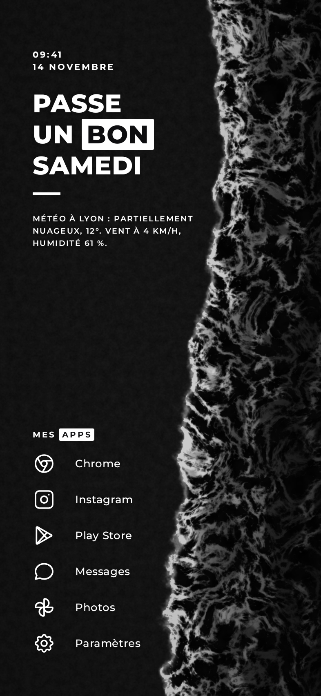
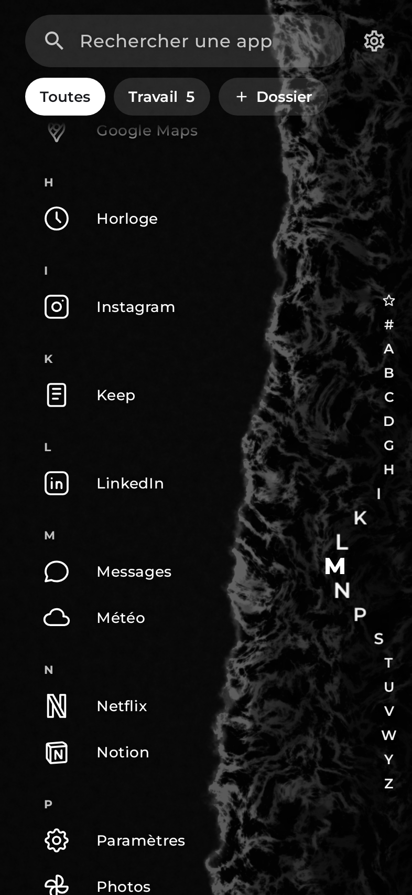
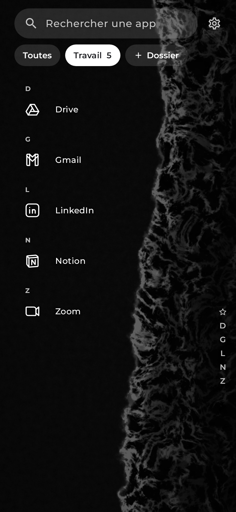
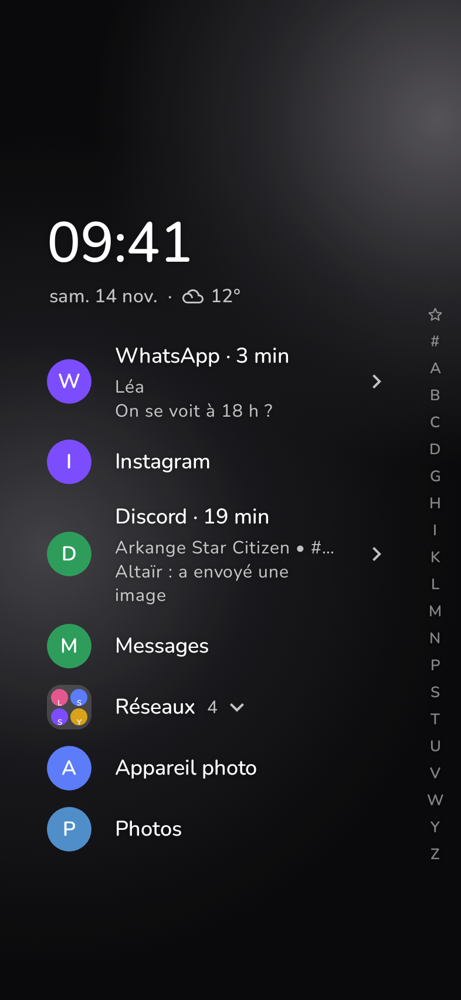
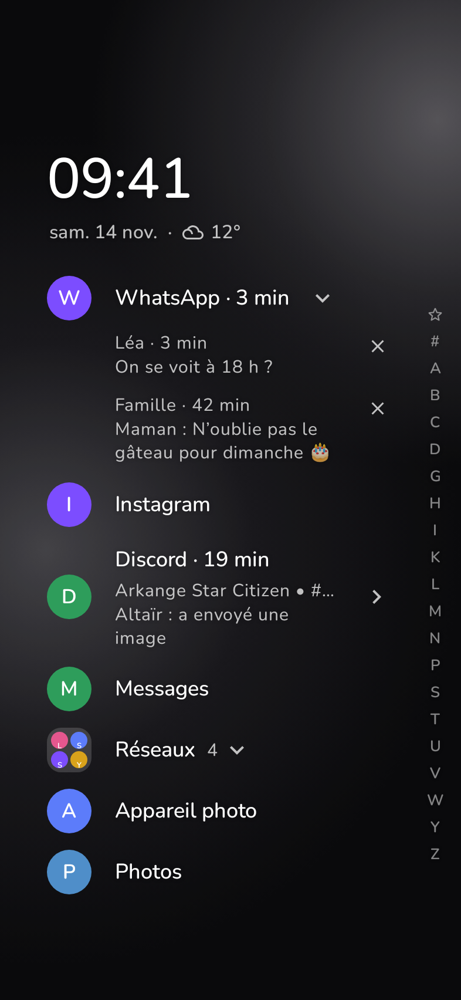
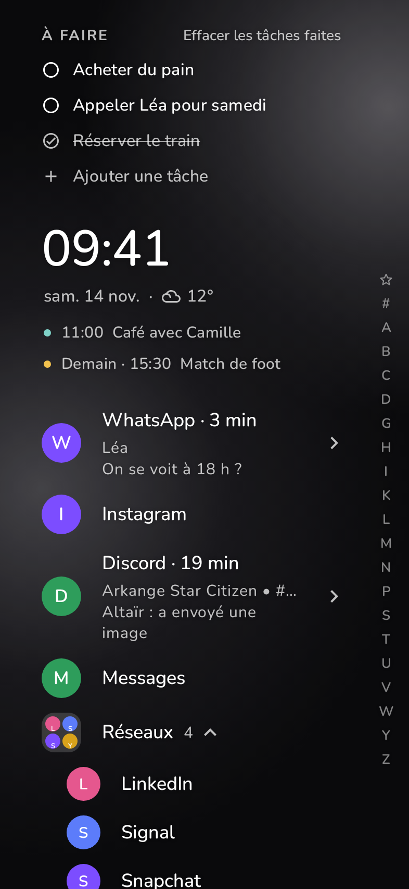
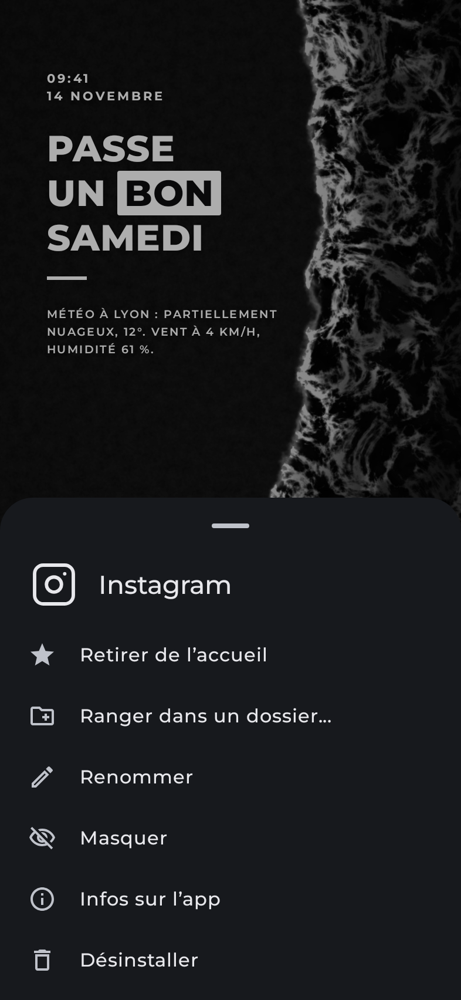
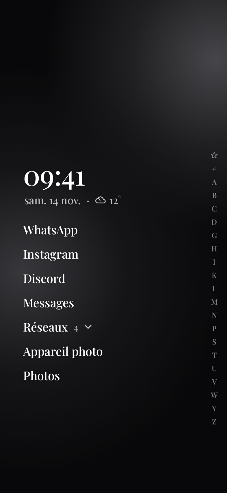

# Épure — mon écran d'accueil Android

Épure est un launcher (écran d'accueil) Android minimaliste, inspiré du principe des launchers
en liste verticale, avec les fonctions qui me manquaient.

**Thème par défaut : « Rivage »** — noir et blanc, grande typographie (« PASSE UN **BON**
DIMANCHE », mot en négatif), petite ligne heure/date, phrase météo en petites capitales,
« MES **APPS** » et des **icônes au trait** blanches pour toutes les apps (logos des apps connues,
pictogrammes des apps système, version monochrome d'Android 13+ sinon). Un fond d'écran
« Rivage » (rivage vu du ciel, généré pour l'app) peut être appliqué depuis Réglages › Thème.
Le thème « Épure » (liste aérée, icônes d'origine) reste disponible au même endroit.

| Rivage : accueil | Rivage : liste et alphabet | Rivage : onglet de dossier |
|---|---|---|
|  |  |  |

Fonctions :

- **Dossiers et catégories** : dossiers sur l'accueil (ils s'ouvrent sur place), onglets de
  dossiers en haut de la liste des apps, rangement automatique par catégorie (Jeux, Musique,
  Réseaux sociaux…).
- **Personnalisation complète, sans abonnement** : renommer et masquer des apps, packs
  d'icônes, polices (dont import d'un fichier `.ttf`/`.otf`), thème clair/sombre, couleurs
  Material You ou couleur d'accent, taille du texte et des icônes, assombrissement du fond
  d'écran, alphabet à droite ou à gauche.
- **Widgets sur l'accueil** : horloge et date, météo (Open-Meteo, sans compte), prochains
  événements de l'agenda, liste de tâches, et n'importe quel widget Android (Google Agenda,
  Keep, météo…).

- **Notifications dans les favoris** : sous le nom de l'app, l'aperçu de la dernière
  notification (« Discord · 19 min », titre, message) ; le chevron déplie toutes les
  notifications de l'app, qu'on peut ouvrir ou effacer.

Et le socle d'un bon launcher : liste alphabétique avec un alphabet latéral « en vague »
(les apps de la lettre touchée viennent se placer à hauteur du doigt, l'étoile ramène aux
favoris), recherche tolérante (sans accents, par initiales), raccourcis d'apps à l'appui
long, glisser vers le haut pour la liste et vers le bas pour les notifications,
sauvegarde/restauration des réglages. Police par défaut : Nunito (ronde, comme les
launchers en liste les plus soignés).

| Épure : accueil | Notifications dépliées | Widgets et dossier | Menu d'une app | Personnalisation |
|---|---|---|---|---|
|  |  |  |  |  |

*Captures générées automatiquement par les tests, avec des apps fictives et un faux fond d'écran.*

## Installer sur le téléphone

1. Télécharger le fichier `.apk` du launcher (envoyé directement, ou onglet **Actions** du
   dépôt › dernier build › *Artifacts* › `epure-apk`).
2. L'ouvrir sur le téléphone. Android demande d'autoriser l'installation depuis cette source :
   accepter.
3. Ouvrir **Épure**, puis appuyer sur **Définir par défaut** et choisir Épure comme
   écran d'accueil.

Pour revenir à l'ancien launcher : Paramètres Android › Applications › Applications par défaut
› Application d'écran d'accueil.

### Notifications sous les apps (facultatif)

Elles passent par un petit module séparé, **Épure Notifications** (`Epure-Notifications.apk`).
Pourquoi séparé : Google Play Protect bloque automatiquement l'installation, hors Play Store,
des apps capables de lire les notifications (« Appli bloquée pour protéger votre appareil »).
Le launcher ne lit donc rien lui-même et ses mises à jour s'installent normalement ; seul le
module est concerné, et on ne l'installe qu'une fois.

1. Play Store › photo de profil › **Play Protect** › ⚙ › désactiver *Analyser les applis
   avec Play Protect*.
2. Installer `Epure-Notifications.apk`, puis **réactiver aussitôt** l'analyse Play Protect.
3. Ouvrir le module (ou Réglages d'Épure › Accueil et widgets › Notifications) ›
   *Autoriser l'accès aux notifications*. Si Android affiche « Paramètre restreint » :
   infos de l'app du module › ⋮ › *Autoriser les paramètres restreints*, puis recommencer.

Le module transmet les notifications uniquement à Épure, sur le téléphone (échange réservé
aux apps signées avec la même clé) : rien n'est enregistré ni envoyé ailleurs.

## Gestes

| Geste | Effet |
|---|---|
| Glisser vers le haut | Liste de toutes les apps |
| Glisser vers le bas | Notifications (désactivable) |
| Glisser le doigt sur l'alphabet | Saut direct à une lettre (l'étoile ramène aux favoris) |
| Toucher l'aperçu d'une notification | Ouvre la notification ; le chevron déplie les autres |
| Appui long sur une app | Raccourcis, favoris, dossier, renommer, masquer, désinstaller |
| Appui long sur un dossier | Modifier, retirer de l'accueil, supprimer |
| Appui long sur une zone vide | Ajouter un widget, nouveau dossier, fond d'écran, réglages |
| Appui long sur un widget Android | Agrandir, réduire, déplacer, retirer |

## Développement

- Kotlin + Jetpack Compose, Android 8.0 (API 26) minimum.
- Compiler : `./gradlew assembleRelease` (APK dans `app/build/outputs/apk/release/` et
  `notifications/build/outputs/apk/release/`). Les deux apps doivent être signées avec la
  même clé.
- Tests : `./gradlew :app:testDebugUnitTest`.
- Régénérer les captures : `./gradlew :app:testDebugUnitTest -Proborazzi.test.record=true`.
- Signature : la clé n'est **jamais** versionnée. Créer `keystore.properties` à la racine :

  ```properties
  storeFile=keystore/epure-release.jks
  storePassword=…
  keyAlias=epure
  keyPassword=…
  ```

  Sans ce fichier, l'APK de release est signé avec la clé de debug.

### Organisation du code

```
app/src/main/java/fr/epure/launcher/
├── MainActivity.kt          écran d'accueil (activité HOME), widgets Android
├── SettingsActivity.kt      réglages (c'est aussi l'icône « Épure » de la liste)
├── data/                    apps installées, configuration (JSON), icônes, météo, agenda,
│                            notifications (reçues du module)
├── domain/                  logique pure : recherche, tri, catégories, codes météo
├── ui/                      interface Compose (accueil, liste, menus, réglages, thème)
└── widgets/                 hôte des widgets Android
app/src/main/res/values/strings.xml   tous les textes de l'app
shared/        lecture des notifications et format d'échange (commun aux deux apps)
notifications/ module « Épure Notifications » (lecteur de notifications, écran d'aide)
```

## Crédits

Données météo : [Open-Meteo](https://open-meteo.com/) (CC BY 4.0).
Polices Montserrat, Nunito, Outfit, Manrope et Playfair Display : SIL Open Font License 1.1.
Icônes au trait : [Tabler Icons](https://tabler.io/icons) (MIT), converties par
`tools/gen_line_icons.py`. Fond d'écran Rivage : généré par `tools/gen_rivage_wallpaper.py`.
Textes complets des licences dans `app/src/main/res/raw/licence_polices.txt` et dans
Réglages › À propos.
