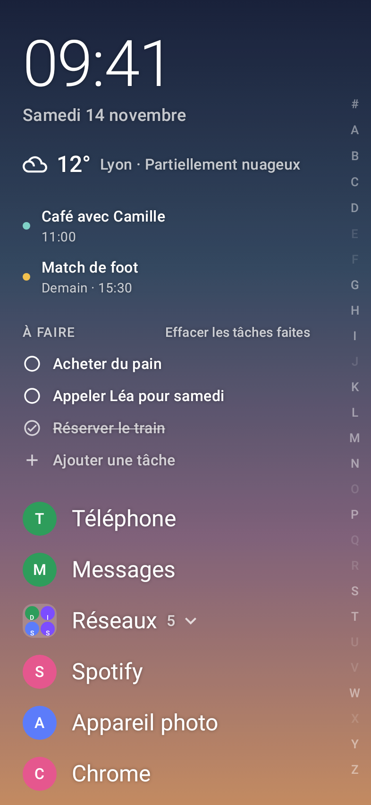
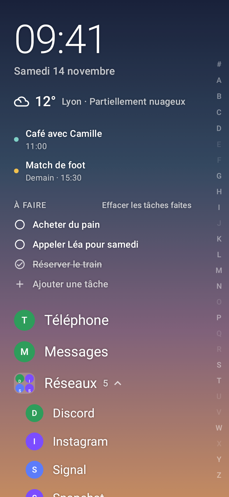
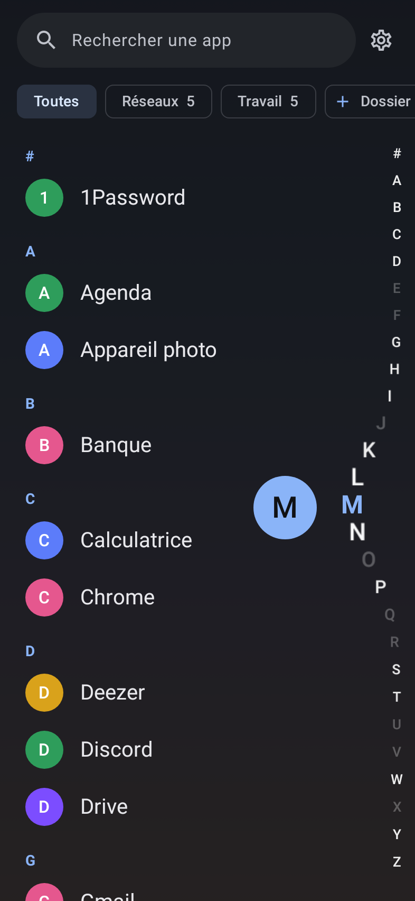
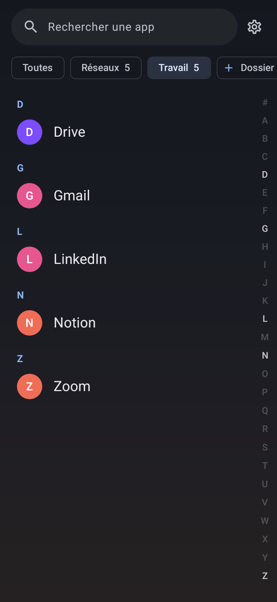
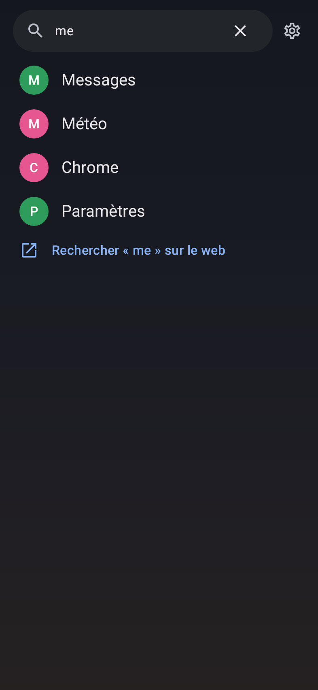
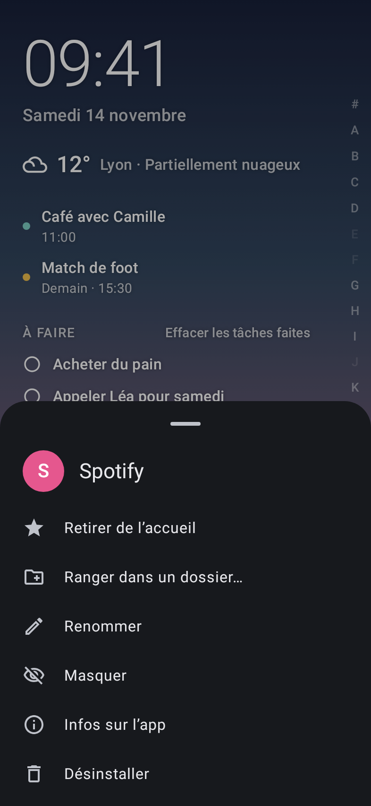
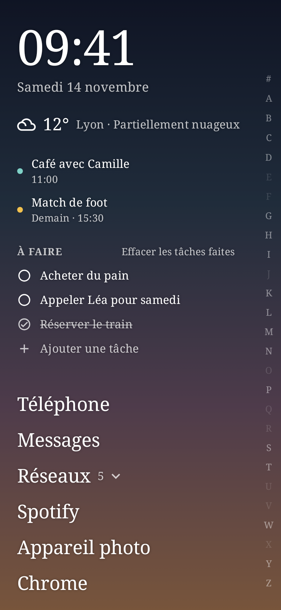

# Épure — mon écran d'accueil Android

Épure est un launcher (écran d'accueil) Android minimaliste, inspiré du principe des launchers
en liste verticale, avec les fonctions qui me manquaient :

- **Dossiers et catégories** : dossiers sur l'accueil (ils s'ouvrent sur place), onglets de
  dossiers en haut de la liste des apps, rangement automatique par catégorie (Jeux, Musique,
  Réseaux sociaux…).
- **Personnalisation complète, sans abonnement** : renommer et masquer des apps, packs
  d'icônes, polices (dont import d'un fichier `.ttf`/`.otf`), thème clair/sombre, couleurs
  Material You ou couleur d'accent, taille du texte et des icônes, assombrissement du fond
  d'écran, alphabet à droite ou à gauche.
- **Widgets sur l'accueil** : horloge et date, météo (Open-Meteo, sans compte), prochains
  événements de l'agenda, liste de tâches, et n'importe quel widget Android (Google Agenda,
  Keep, météo…).

Et le socle d'un bon launcher : liste alphabétique avec un alphabet latéral « en vague »,
recherche tolérante (sans accents, par initiales), raccourcis d'apps à l'appui long, glisser
vers le haut pour la liste et vers le bas pour les notifications, sauvegarde/restauration
des réglages.

| Accueil | Dossier ouvert | Liste et alphabet | Onglet de dossier |
|---|---|---|---|
|  |  |  |  |

| Recherche | Menu d'une app | Personnalisation |
|---|---|---|
|  |  |  |

*Captures générées automatiquement par les tests, avec des apps fictives et un faux fond d'écran.*

## Installer sur le téléphone

1. Télécharger le fichier `.apk` (envoyé directement, ou onglet **Actions** du dépôt ›
   dernier build › *Artifacts* › `epure-apk`).
2. L'ouvrir sur le téléphone. Android demande d'autoriser l'installation depuis cette source :
   accepter.
3. Ouvrir **Épure**, puis appuyer sur **Définir par défaut** et choisir Épure comme
   écran d'accueil.

Pour revenir à l'ancien launcher : Paramètres Android › Applications › Applications par défaut
› Application d'écran d'accueil.

## Gestes

| Geste | Effet |
|---|---|
| Glisser vers le haut | Liste de toutes les apps |
| Glisser vers le bas | Notifications (désactivable) |
| Glisser le doigt sur l'alphabet | Saut direct à une lettre |
| Appui long sur une app | Raccourcis, favoris, dossier, renommer, masquer, désinstaller |
| Appui long sur un dossier | Modifier, retirer de l'accueil, supprimer |
| Appui long sur une zone vide | Ajouter un widget, nouveau dossier, fond d'écran, réglages |
| Appui long sur un widget Android | Agrandir, réduire, déplacer, retirer |

## Développement

- Kotlin + Jetpack Compose, Android 8.0 (API 26) minimum.
- Compiler : `./gradlew :app:assembleRelease` (APK dans `app/build/outputs/apk/release/`).
- Tests : `./gradlew :app:testDebugUnitTest`.
- Régénérer les captures : `./gradlew :app:testDebugUnitTest -Proborazzi.test.record=true`.
- Signature : la clé n'est **jamais** versionnée. Créer `keystore.properties` à la racine :

  ```properties
  storeFile=keystore/epure-release.jks
  storePassword=…
  keyAlias=epure
  keyPassword=…
  ```

  Sans ce fichier, l'APK de release est signé avec la clé de debug.

### Organisation du code

```
app/src/main/java/fr/epure/launcher/
├── MainActivity.kt          écran d'accueil (activité HOME), widgets Android
├── SettingsActivity.kt      réglages (c'est aussi l'icône « Épure » de la liste)
├── data/                    apps installées, configuration (JSON), icônes, météo, agenda
├── domain/                  logique pure : recherche, tri, catégories, codes météo
├── ui/                      interface Compose (accueil, liste, menus, réglages, thème)
└── widgets/                 hôte des widgets Android
app/src/main/res/values/strings.xml   tous les textes de l'app
```

## Crédits

Données météo : [Open-Meteo](https://open-meteo.com/) (CC BY 4.0).
